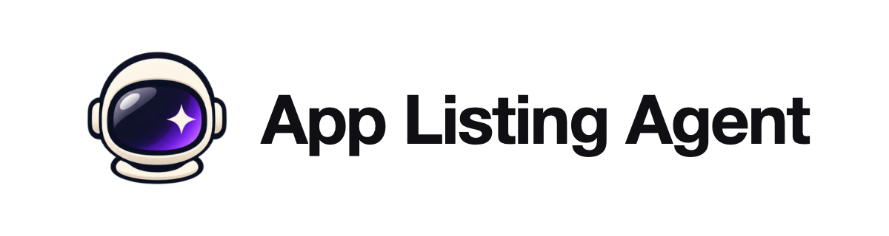
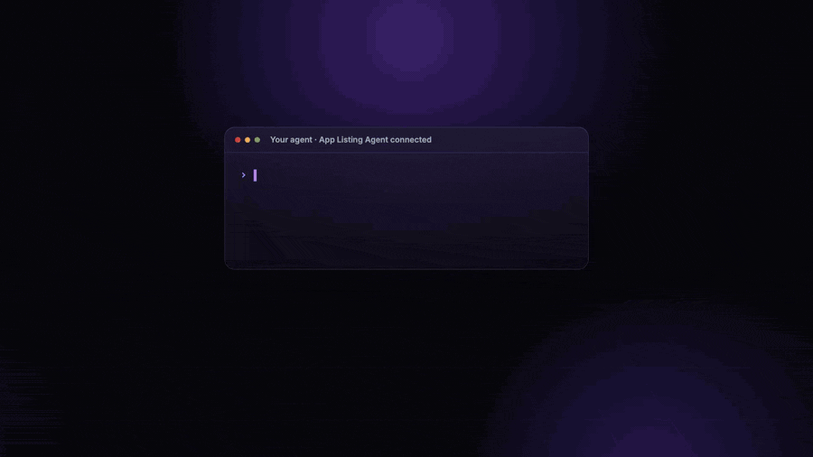
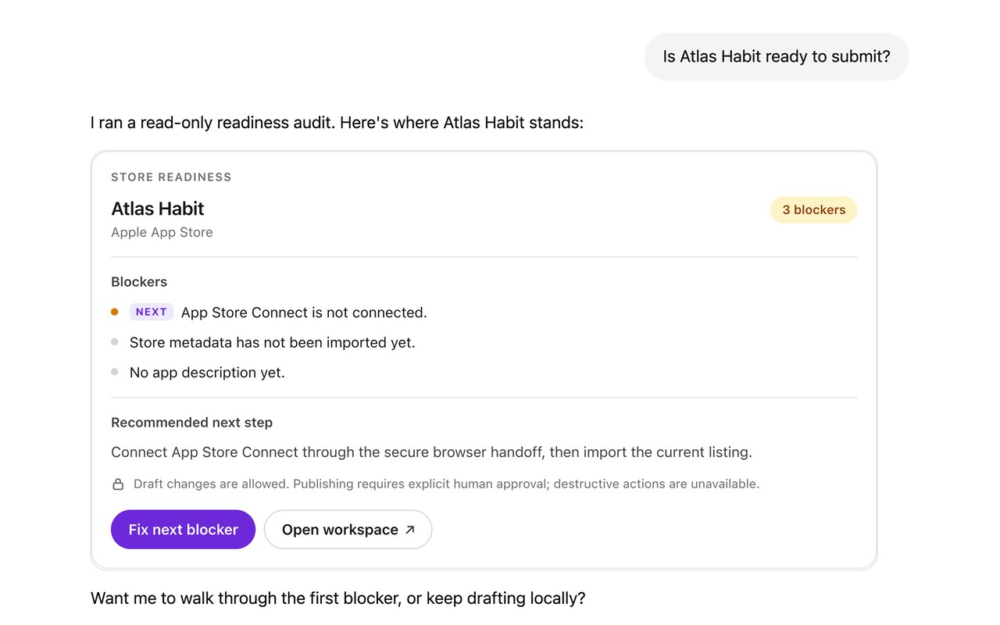
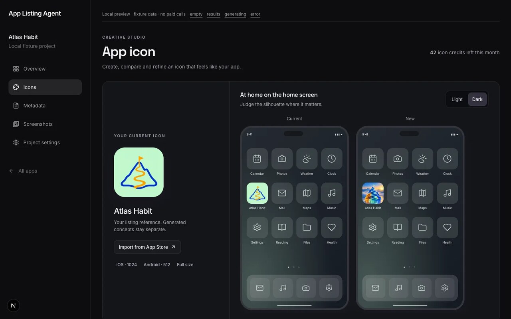
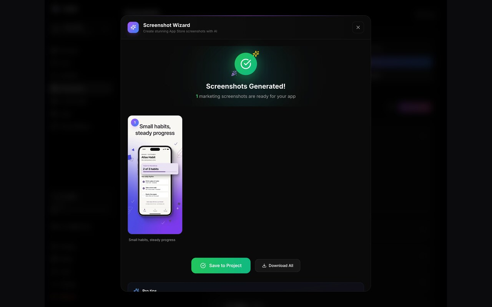
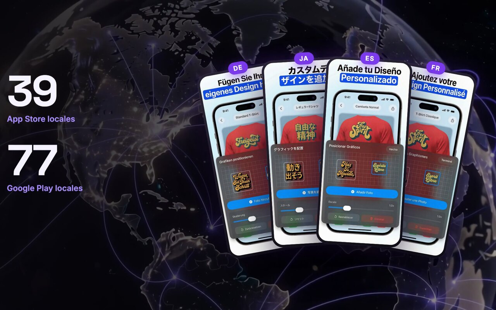

<p align="center">
  <a href="https://applistingagent.com" target="_blank">
    <picture>
      <source media="(prefers-color-scheme: dark)" srcset=".github/assets/logo-dark.png">
      
    </picture>
  </a>
</p>

<p align="center">
  <a href="LICENSE"></a>
  <a href="https://github.com/AppAgentic/app-listing-agent/stargazers"></a>
  <a href="https://github.com/AppAgentic/app-listing-agent/actions/workflows/ci.yml"></a>
</p>

<div align="center">
  <strong>
    <a href="https://applistingagent.com">App Listing Agent</a> is an open-source App Store Connect and Google Play agent: metadata, screenshots, icons, translations, in-app purchases and launch readiness, driven from your AI agent with approval before anything is published.

  Use App Listing Agent Cloud for a fully managed experience, or deploy the open-source edition on your own infrastructure.
  </strong>
</div>

<p align="center">
  <br />
  <a href="https://applistingagent.com/docs"><strong>Explore the docs »</strong></a>
  <br />
</p>

<p align="center">
  <a href="https://applistingagent.com/login?mode=signup&source=github">Cloud sign-up</a>
  ·
  <a href="https://applistingagent.com/docs/mcp">MCP docs</a>
  ·
  <a href="docs/self-hosting.md">Self-hosting guide</a>
  ·
  <a href="https://github.com/AppAgentic/app-listing-agent/discussions">Discussions</a>
  ·
  <a href="https://github.com/AppAgentic/app-listing-agent/issues">Issues</a>
  ·
  <a href="CONTRIBUTING.md">Contributing</a>
</p>

<br />

<p align="center"><strong>Manage listings on:</strong></p>
<div align="center">
  
  
</div>

<p align="center"><strong>With your favorite AI agent:</strong></p>
<div align="center">
  <a href="https://applistingagent.com/docs/mcp/installation" title="ChatGPT"></a>
  <a href="https://applistingagent.com/docs/mcp/installation" title="Claude"></a>
  <a href="https://applistingagent.com/docs/mcp/installation" title="Claude Code"></a>
  <a href="https://applistingagent.com/docs/mcp/installation" title="Codex"></a>
  <a href="https://applistingagent.com/docs/mcp/installation" title="Cursor"></a>
  <a href="https://applistingagent.com/docs/mcp" title="MCP server (any remote-MCP client)"></a>
</div>

<br />

## See it in action

<p align="center">
  <a href="https://screens.appstorecopilot.com/marketing/vsl/v6/app-listing-agent-1080.mp4" target="_blank">
    
  </a>
  <br />
  <sub>13 seconds from the 85-second demo. <a href="https://screens.appstorecopilot.com/marketing/vsl/v6/app-listing-agent-1080.mp4">Watch the full video (with sound)</a>.</sub>
</p>

## Features

|  |  |
| :---: | :---: |
| **Store readiness audit in your agent.** Blockers and the recommended next step, rendered as an interactive MCP App in hosts that support it. | **Icon studio.** Generate concepts in ten style presets and judge them on a real home screen before you ship. |
|  |  |
| **Marketing screenshots.** Turn raw app captures into store-ready screenshots, then save them to the project. | **Every locale.** Translate metadata and the text inside screenshots across all 50 App Store and 83 Google Play locales. |

## What it does

- **Metadata for both stores.** Edit titles, subtitles, descriptions, keywords, promotional text and release notes per locale, check them against store length limits and review guidelines, translate them with AI, and push them to App Store Connect and Google Play (with a dry-run preview first).
- **Screenshots.** Generate marketing screenshots from raw app captures, build whole sets from a plan, edit them with a prompt, translate the text in them into other languages, import existing ones from the stores, and upload them to the right device slots (including the App Store Asset Library).
- **Icons.** Generate app icon concepts and variations in ten style presets, resize to every required size, and import your current App Store icon.
- **In-app purchases and subscriptions.** Create and update App Store IAPs, subscription groups, subscriptions, pricing across territories, introductory and promotional offers, and their translations; Google Play products, subscriptions, base plans and offers. Optional RevenueCat sync.
- **Custom product pages and custom store listings.** Create, write, translate and sync iOS custom product pages and Google Play custom store listings, with their own screenshots and icons.
- **Store readiness audit.** Check a project for launch blockers and get the next step, shown as an interactive report in MCP hosts that support MCP Apps (such as ChatGPT and Claude).
- **Legal pages.** Host your privacy policy and terms and link them in App Store Connect.
- **Support and stability (optional).** Read and answer Gleap support tickets, manage help articles, and triage Firebase Crashlytics issues from the same agent.
- **An MCP server with about 200 tools.** 55 reviewed tools are on by default; the integration tools (IAP, RevenueCat, Gleap, Crashlytics, Firebase) can be turned on per account.
- **Approval before publishing.** Agents get scoped keys or OAuth access. Store writes support dry runs, and live changes wait for the account owner's approval in the dashboard.

## Quick start

### Cloud

The fastest way: sign up at **[applistingagent.com](https://applistingagent.com)**, connect App Store Connect or Google Play, and add the MCP server to your agent. No servers, no API keys for AI providers.

### Self-host with Docker

You need a Firebase project (Authentication + Firestore), a Cloudflare R2 bucket and your own AI provider keys. The [self-hosting guide](docs/self-hosting.md) walks through each step.

```bash
git clone https://github.com/AppAgentic/app-listing-agent.git
cd app-listing-agent
cp .env.example .env          # fill it in: docs/self-hosting.md
docker compose up -d --build
open http://localhost:3000
```

Then connect an agent:

```json
{
  "mcpServers": {
    "app-listing-agent": {
      "url": "http://localhost:3000/api/mcp",
      "headers": { "Authorization": "Bearer asc_live_..." }
    }
  }
}
```

### Cloud vs self-host

Choose [App Listing Agent Cloud](https://applistingagent.com) for a fully managed experience, or run the open-source edition on your own infrastructure. Both are the same product: self-hosted installs have billing switched off and no plan limits.

| | Cloud | Self-host |
|---|---|---|
| Price | Paid plans with a 7-day free trial | Free, AGPL-3.0; you pay for your own infrastructure and AI usage |
| Setup | Sign up and connect a store in minutes | Firebase, an R2 bucket, Docker and HTTPS ([guide](docs/self-hosting.md)) |
| Hosting and data | Hosted by App Agentic | Your own Firebase project and bucket |
| Apps, translations, screenshots, icons | Limited by plan | No limits |
| AI for screenshots, icons, translations | Included, keys managed for you | Your own Gemini / OpenAI / fal.ai keys |
| Background jobs (screenshot translation and push) | Included | Deploy the Cloud Functions in `functions/` |
| Agent access (MCP) | Hosted endpoint with OAuth sign-in or scoped API keys | Point any MCP client at your instance with an API key, or your own OAuth |
| Updates and backups | Handled for you | You pull updates and run backups |
| Support | Email and in-app | GitHub issues |
| Source access | Same application code, operated by us | Full source; fork and modify under the AGPL |

## How it compares

App Listing Agent is about **store listings and monetisation**, driven by agents. It does not build, sign or upload your app binary.

| | App Listing Agent | [fastlane](https://github.com/fastlane/fastlane) | [asc](https://github.com/rorkai/App-Store-Connect-CLI) (App Store Connect CLI) |
|---|---|---|---|
| Form | Web dashboard + MCP server | Ruby CLI and CI toolkit | CLI |
| Stores | App Store and Google Play | App Store and Google Play | App Store |
| Builds, code signing, TestFlight and binary upload | No | **Yes, its core strength** (match, gym, pilot) | **Much wider App Store Connect API coverage**, including TestFlight |
| Screenshot capture from UI tests | No (imports or generates) | **Yes** (snapshot, screengrab) | No |
| AI generation (screenshots, icons, translations, copy) | Yes | No | No |
| In-app purchases and subscriptions | Yes, both stores | Not a focus | App Store |
| Agent access with approval before publishing | Yes (MCP, scoped keys, OAuth) | No | Scriptable by agents; no approval layer |
| Runs without a server or database | No (needs Firebase) | **Yes** | **Yes** |
| Maturity and ecosystem | New | **Since 2014, large plugin ecosystem** | Younger, active |
| License | AGPL-3.0 | MIT | MIT |

If you need CI builds, signing and binary uploads, use fastlane or asc for that. Many teams will run them side by side with App Listing Agent handling listings, assets and pricing.

## Tech stack

Next.js 16 (App Router) · TypeScript · Firebase Authentication and Firestore · Cloud Functions workers · Cloudflare R2 · Gemini, OpenAI and fal.ai · Tailwind CSS and Radix UI · Vitest. See [AGENTS.md](AGENTS.md) for the architecture.

## Star History

<a href="https://star-history.com/#AppAgentic/app-listing-agent&Date">
  <picture>
    <source media="(prefers-color-scheme: dark)" srcset="https://api.star-history.com/svg?repos=AppAgentic/app-listing-agent&type=Date&theme=dark">
    
  </picture>
</a>

## Contributing

Bug reports, fixes and features are welcome. Read [CONTRIBUTING.md](CONTRIBUTING.md) for setup and PR rules. Contributors sign a short [CLA](CLA.md) on their first pull request. Please report security problems privately as described in [SECURITY.md](SECURITY.md).

## License

[GNU Affero General Public License v3.0](LICENSE). Copyright © 2026 App Agentic Ltd.

You can use, modify and self-host App Listing Agent for free. If you run a modified version for other people over a network, the AGPL requires you to publish your changes under the same license. "App Listing Agent" and its logo are trademarks of App Agentic Ltd and are not licensed under the AGPL.
